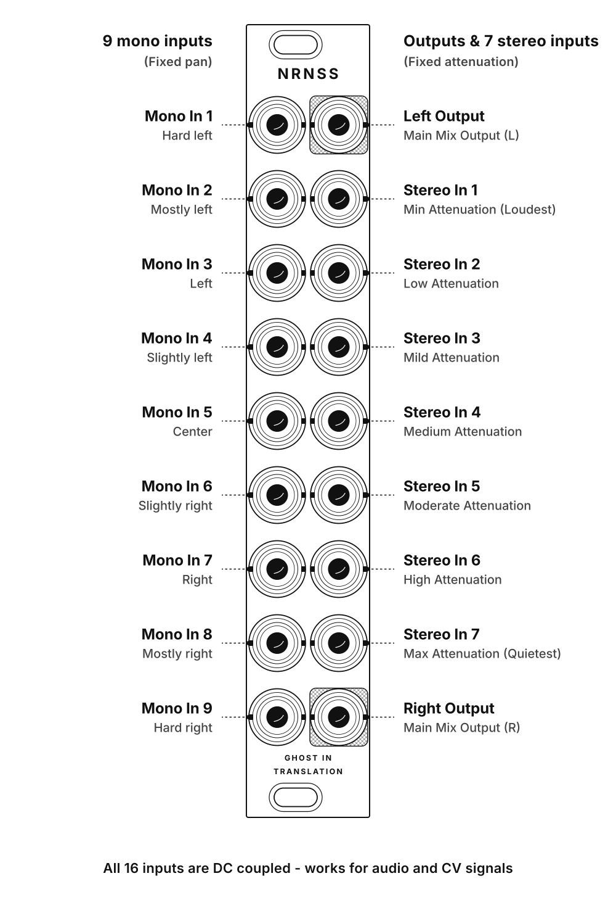

---
pdf_options:
  format: A4
  margin:
    top: 0
    right: 0
    bottom: 0
    left: 0
  printBackground: true
  displayHeaderFooter: false
---

  

    
Ghost In Translation

    <h1 class="cover-title">NRNSS</h1>
    
1.0.X

  

  <!-- Table of Contents Section -->
  <h2 class="toc-heading">Table of Contents</h2>
  <ul class="toc-list">
    <li>
      1. Introduction
      
      3
    </li>
    <li>
      2. Installation
      
      4
    </li>
    <li>
      3. How it works
      
      5
    </li>
    <li>
      4. Troubleshooting
      
      7
    </li>
  </ul>
  <!-- Page footer with page number 2 -->
  

    NRNSS User Manual
    Page 2
  

  <!-- Section 1: Introduction -->
  <h1>1. Introduction</h1>

  
NRNSS is a minimal mixer module for spacing out your sounds in the stereo field, based on the open source Nearness design but reworked from the ground up to provide more features and better sound quality.

  <h2>Features</h2>

  <ul>
    <li>9 mono inputs</li>
    <li>7 stereo inputs</li>
    <li>Fully DC-coupled</li>
    <li>Very quiet</li>
  </ul>
  
  <h2>Technical Specifications</h1>

  <ul>
    <li><strong>Module Width</strong>: 4 HP</li>
    <li><strong>Depth</strong>: 25 mm</li>
    <li><strong>Power Consumption</strong>:
      <ul>
        <li><strong>+12V</strong>:  mA</li>
        <li><strong>-12V</strong>:  mA</li>
      </ul>
    </li>
  </ul>
  
  <!-- Page footer with page number 3 -->
  

    NRNSS User Manual
    Page 3
  

  <!-- Section 2: Installation -->
  <h1>2. Installation</h1>

  
Turn off and disconnect your Eurorack case from AC mains power before installing this module. Connect the supplied power ribbon cable to the module and your busboard. Make sure that the red stripe on the cable is connected to -12V (as shown on the back of the module).

  
  <!-- Page footer with page number 4 -->
  

    NRNSS User Manual
    Page 4
  

  <!-- Section 3: Controls and CV Inputs -->
  <h1>3. How it works</h1>

  
NRNSS has 16 DC-coupled inputs, meaning that they accept both CV and audio signals. When unpatched, they’re normalled (internally connected) to 0V.

  
The left column is made of 9 mono inputs and the right column has the 2 outputs, top and bottom, as well as 7 stereo TRS inputs in between.

  
On the left, the closest a mono input is to an output, the greater its influence on it, either audio getting louder or CV getting more or less attenuated. The inputs are scaled with 3 dB between one another, meaning that between each input there is a gain difference that feels linear to the human ear.

  
On the right, from top to bottom the stereo inputs have increasing attenuation, also scaled with 3 dB bettween on another. This allows to mix in loud and quiet sources and make them sound equally loud in the final mix.

  
  <!-- Page footer with page number 5 -->
  

    NRNSS User Manual
    Page 5
  

  <!-- Signal routing and panel layout diagram -->
  
  
  <!-- Page footer with page number 5 -->
  

    NRNSS User Manual
    Page 6
  

  <!-- Section 9: Troubleshooting -->
  <h1>4. Troubleshooting</h1>

  <h2>No Sound Output</h2>
  <ul>
    <li>Verify that the eurorack power ribbon cable is connected in the right polariry. If not it may damage the module.</li>
    <li>Make sure your audio cables are patched securely.</li>
    <li>Switch off and switch on the module.</li>
  </ul>
  
  <!-- Page footer with page number 12 -->
  

    NRNSS User Manual
    Page 7
  

